# BuildBuddy

**Your Build Has Feelings.**

BuildBuddy turns build status, test failures, and coverage into expressive animated SVG companions. Embed a robot, cat, or ghost in a README, dashboard, documentation page, or website. Use the public API directly, or generate SVGs locally with the same Go rendering engine. No account or API key is required.

## Use the hosted API

Embed a mascot using BuildBuddy's public URL. No installation or deployment is required.

**Production URL placeholder:** `https://YOUR-BUILDBUDDY-PROJECT.vercel.app`. The examples below will use the confirmed production domain once it is assigned.

```markdown

```

You can also download the generated SVG:

```bash
curl -f 'https://YOUR-BUILDBUDDY-PROJECT.vercel.app/v1/mascot.svg?status=passing&character=cat' -o mascot.svg
```

The same URL works in an HTML `` element, a dashboard, or a documentation page. The SVG has a square `viewBox`, an accessible title/description, and no scripts or external resources.

## Preview

These are actual SVGs generated by the included CLI:

<p>
  
  
  
</p>

## Features

- Three original vector characters, five unmistakable moods, three coordinated themes.
- Gentle bounce, shake, working motion, floating, blinks, and tail movement. Supports `prefers-reduced-motion` and `animate=false`; static artwork remains complete.
- Coverage celebrations and warnings, worried expressions for many failures, and a running progress bar.
- Shared HTTP/CLI validation and rendering, deterministic output, content-based ETags.
- Standard-library-only Go, safe XML escaping, strict input limits, graceful shutdown, non-root Docker image.

## API

All endpoints support `GET` and `HEAD`. Trailing slashes are not aliases.

| Endpoint | Response |
| --- | --- |
| `/healthz` | `{"status":"ok"}` |
| `/v1/mascot.svg` | `image/svg+xml` mascot |
| `/v1/mascot.json` | Resolved configuration, mood, animation, and visual flags |
| `/v1/characters` | Array of `{name, description}` objects |
| `/v1/themes` | `["light","dark","neon"]` |

The two mascot endpoints accept identical parameters:

| Parameter | Default | Accepted values |
| --- | --- | --- |
| `status` | `unknown` | `passing`, `failing`, `running`, `queued`, `unknown` |
| `character` | `robot` | `robot`, `cat`, `ghost` |
| `theme` | `light` | `light`, `dark`, `neon` |
| `coverage` | omitted | Decimal integer, 0–100 |
| `failed_tests` | omitted | Decimal integer, 0–100000 |
| `progress` | omitted | Decimal integer, 0–100 |
| `animate` | `true` | Exactly `true` or `false` |
| `size` | `300` | Width and height in pixels, integer 100–1000 |
| `message` | generated | Valid UTF-8, at most 80 Unicode characters; no XML-invalid/control characters |

Values are case sensitive. Unknown keys, duplicates, empty enums/numbers, signed/fractional numbers, malformed URL encodings, and out-of-range values return `400`. An empty `message` selects the generated caption. Escape custom captions with your URL library or `curl --data-urlencode`; they are always XML escaped. Long captions wrap and wide text is fitted to the card.

Mood rules are deterministic:

| Status | Mood | Motion |
| --- | --- | --- |
| `passing` | happy | Bounce and celebration |
| `failing` | stressed | Brief, restrained shake |
| `running` | focused | Working sway and blinks |
| `queued` | sleepy | Floating and closed eyes |
| `unknown` | curious | Subtle movement and blinks |

Coverage never changes explicit status. Passing coverage ≥90 adds extra celebration; <50 adds a coverage hint. Coverage may describe the last measured run for any status. Positive `failed_tests` requires `failing`; `failing` with zero failed tests is contradictory (omit the count for a non-test failure). Ten or more failures add worry marks. `progress` requires `running`; even 100 does not infer a passing result. An explicit message overrides only the caption. `animate=false` resolves animation to `none`.

```bash
curl -f 'https://YOUR-BUILDBUDDY-PROJECT.vercel.app/v1/mascot.json?status=failing&failed_tests=4&theme=dark'
```

```json
{"character":"robot","status":"failing","theme":"dark","coverage":null,"failed_tests":4,"progress":null,"animate":true,"size":300,"message":"4 failing tests","mood":"stressed","animation":"shake","celebration":false,"coverage_warning":false,"worried":false}
```

Optional numeric fields are consistently `null` when omitted. Invalid input returns a predictable error:

```json
{"error":{"code":"INVALID_PARAMETER","message":"coverage must be between 0 and 100"}}
```

Unknown routes return `404 NOT_FOUND`; unsupported methods return `405 METHOD_NOT_ALLOWED` and `Allow: GET, HEAD`. Oversized queries return `414 URI_TOO_LONG`; unexpected internal failures return generic `500 INTERNAL_ERROR`. Errors and health responses use `Cache-Control: no-store`.

### Examples

Append these paths to the public API base URL above:

```text
/v1/mascot.svg?status=passing&coverage=96
/v1/mascot.svg?status=failing&failed_tests=4
/v1/mascot.svg?status=running&progress=65
/v1/mascot.svg?status=queued&character=ghost
/v1/mascot.svg?status=passing&character=cat&theme=neon
/v1/mascot.svg?status=passing&theme=dark&animate=false&size=500
```

### Determinism and caching

Identical normalized parameters produce identical SVG bytes for a given application version. Query order and explicit defaults do not affect output. ETags are SHA-256 hashes of the actual response bytes; `If-None-Match` supports strong, weak, list, and wildcard matches, returning a bodyless `304`.

Mascot responses use `public, max-age=60, must-revalidate`; character/theme lists use `public, max-age=3600`. There is no in-memory result cache.

**The endpoint reflects the supplied parameters.** A fixed URL with `status=passing` always represents passing; it does not discover your current CI state. Update the parameters, replace a generated file, or provide a separate integration when the build changes.

## Embed a mascot in your README

### A. Public API URL

Use the hosted BuildBuddy API directly:

```markdown

```

This displays the specified status. It does not read GitHub Actions results.

### B. Automatically reflect test results

For a mascot that changes with your test results, generate and publish an SVG from CI. The included workflow uses the local renderer and requires no API server deployment.

Copy [the complete example](examples/github-actions.yml) to `.github/workflows/mascot.yml`. It uses the included [test-result renderer](examples/render-test-result.sh) and [publication script](examples/publish-mascot.sh). Keep both scripts when adapting it elsewhere, and change the test/build commands as needed. Change `main` in the push trigger if your default branch differs. The test job has read-only access; only the publication job gets `contents: write`. Repository/organization policies must allow that job to push to the dedicated **`badge-artifact`** branch. Reserve that branch for generated artwork.

The workflow builds the local renderer, runs tests, generates a passing or failing SVG, transfers it as a workflow artifact, then commits `mascot.svg` to the badge branch. Unchanged artwork creates no commit. Publication still runs after failing tests, and the workflow ultimately reports failure. Development branches are untouched. A compile/setup failure or cancellation cannot generate a fresh mascot and leaves the previous image in place.

The publishing workflow runs only on the default branch or manual dispatch for that branch. The included CI workflow excludes badge-branch pushes; the badge branch contains only the SVG, and the repository token also [avoids recursive push workflows](https://docs.github.com/en/actions/concepts/security/github_token). Pull-request tests receive no publishing permission.

Once the first publish succeeds, replace the clearly marked owner/repository placeholders and embed:

```markdown

```

Use a public repository for an anonymously accessible raw image. This URL references the actual branch/file the workflow publishes. Downloadable workflow artifacts alone are not permanent README image hosting. The example targets GitHub.com hosted runners, not GitHub Enterprise Server.

GitHub's [image proxy caches images](https://docs.github.com/en/authentication/keeping-your-account-and-data-secure/about-anonymized-urls), so updates can appear with a delay. Hosts, sanitizers, and clients can limit SVG animation; the static drawing still communicates status. For clients that suppress animation, use `--animate=false` or distribute a static export. No instant refresh or universal animation support is promised.

## Development and maintainer operations

The hosted API requires no local setup. The instructions below are for contributors, local CLI use, and service maintainers.

<details>
<summary>Local development, Docker, tests, and Vercel configuration</summary>

### Requirements and installation

Go **1.26 or later**, using a supported stable patch release. Docker is optional. There are no third-party Go dependencies, so no `go.sum` is needed.

No remote repository is configured yet. **Replace `YOUR-OWNER/YOUR-REPO` below with your actual repository** after publishing:

```bash
git clone https://github.com/YOUR-OWNER/YOUR-REPO.git buildbuddy
cd buildbuddy
go build -trimpath -o bin/buildbuddy ./cmd/buildbuddy
./bin/buildbuddy serve
```

From the checked-out source, `go install ./cmd/buildbuddy` installs the binary into `GOBIN` (or `GOPATH/bin`). The module currently uses the local name `buildbuddy`; set a real module path and update imports before offering remote `go install ...@version` instructions.

### Run the local server

```bash
go run ./cmd/buildbuddy serve
```

In another terminal:

```bash
curl -f 'http://localhost:8080/healthz'
curl -f 'http://localhost:8080/v1/mascot.svg?status=passing&character=cat' -o mascot.svg
```

Open `mascot.svg` in a browser, or use it as an image. The SVG has a square `viewBox`, an accessible title/description, and no scripts or external resources.

### Local server configuration

| Variable | Default | Validation |
| --- | --- | --- |
| `HOST` | `0.0.0.0` | IPv4/IPv6 address or `localhost` |
| `PORT` | `8080` | Integer, 1–65535 |

```bash
HOST=127.0.0.1 PORT=9090 ./bin/buildbuddy serve
```

Empty environment values use defaults. Invalid settings or a busy port fail with a useful error. SIGINT/SIGTERM drains requests for up to ten seconds. JSON logs include method, recognized route, response status, and duration; query strings, custom messages, and arbitrary unmatched paths are excluded.

The server uses 5s header, 10s read, 15s write, and 60s idle timeouts, a 16 KiB header limit, a 4 KiB query limit, and 64 simultaneous handlers. Excess concurrency returns JSON `503 BUSY` with `Retry-After: 1`. Request bodies are rejected. Put a TLS reverse proxy in front of public deployments; set connection and per-client rate limits there if needed. The service itself requires no writable filesystem.

### Docker

```bash
docker build -t buildbuddy:local .
docker run --rm --read-only --cap-drop=ALL --security-opt=no-new-privileges \
  -p 127.0.0.1:8080:8080 buildbuddy:local
```

The multi-stage build produces a static binary in a `scratch` image running as UID/GID 65532. It has no shell or extra packages. Override the listen port with, for example, `-e PORT=9090 -p 127.0.0.1:9090:9090`. For public access, expose it through your TLS proxy. Image construction needs the Go base image; the built image runs offline.

### Tests and CI

```bash
gofmt -w main.go cmd internal
go test ./...
go test -race ./...
go vet ./...
go build -trimpath -o bin/buildbuddy ./cmd/buildbuddy
go test ./internal/mascot -run '^$' -bench BenchmarkRender -benchmem
# Optional fuzzing:
go test ./internal/mascot -run '^$' -fuzz FuzzRender -fuzztime 10s
```

Tests cover mood rules, all 45 character/status/theme combinations with and without animation, XML validity, injection attempts, Unicode and numeric boundaries, deterministic concurrent rendering, HTTP errors/caching/HEAD, CLI output, byte-for-byte API/CLI parity, environment validation, live HTTP startup, and graceful shutdown. A repeatable integration test runs genuinely passing and failing Go tests, invokes the exact rendering/publication scripts used by the workflow, then reads the published SVG through a separate Git checkout. It checks both status transitions, unchanged-image no-ops, and an untouched development branch. The publishing integration test needs Git and Bash. Server integration tests require loopback networking; race detection requires a supported platform and C toolchain. `.github/workflows/ci.yml` checks formatting, vet, tests, race detection, compilation, and a rendered SVG parsed with Python's standard library.

### Maintainers: Vercel deployment

The repository includes `vercel.json` with Vercel's [Go framework preset](https://vercel.com/docs/functions/runtimes/go). The root `main.go` and the local CLI both call `internal/app`, preserving the same handlers, rendering, and server lifecycle. Vercel supplies `PORT`; the application already reads it.

Connect this repository to the Vercel project, select `main` as its Production Branch, and keep the repository root as the project root. [Pushes to the production branch trigger automatic deployments](https://vercel.com/docs/git). The public production domain serves the updated API after a successful build and deployment.

Replace the production URL placeholder in this README with the stable production domain once it is available. Consumers then embed that URL directly. Deployment of BuildBuddy updates the service; each mascot still reflects the status parameters supplied to it.

</details>

## Generate SVG locally

The CLI uses exactly the same engine and validation as HTTP, without starting a server:

```bash
go run ./cmd/buildbuddy render \
  --status passing --character robot --theme dark \
  --coverage 96 --output mascot.svg

./bin/buildbuddy render --status failing --failed_tests 4 --animate=false --output mascot.svg
./bin/buildbuddy render --status queued --character ghost --output - > mascot.svg
./bin/buildbuddy render --help
```

All query parameters have matching CLI flags. Boolean values must be explicit (`--animate=false`); repeated flags are rejected. Output defaults to `mascot.svg`; `--output -` writes only SVG to stdout. Existing output files are overwritten; parent directories must already exist.

## Project layout

```text
main.go                 Vercel Go entry point
vercel.json             Hosted Go runtime and deployment configuration
cmd/buildbuddy/          Local command entry point
internal/app/           Shared CLI/server lifecycle and integration tests
internal/config/        Environment configuration and tests
internal/mascot/        Model, mood rules, SVG artwork, tests, benchmarks, fuzz target
internal/api/           HTTP handlers, caching, safeguards, and tests
examples/previews/      Real generated SVG previews
examples/github-actions.yml
.github/workflows/ci.yml
Dockerfile
```

## License

[MIT](LICENSE), including the original SVG artwork.
